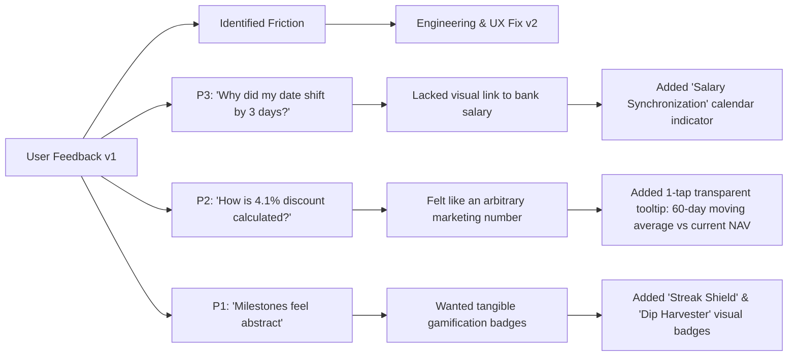

# Part 6: User Testing & Prototype Feedback

## 1. Executive Summary & Testing Objectives
To validate the **Groww PulseSIP** intervention suite before production rollout, we conducted moderated usability testing sessions with 3 target first-time mutual fund investors across Months 3–5 of their SIP journey.

The testing evaluated three core hypotheses:
1. **Hypothesis 1 (Cognitive Reframing):** Displaying discounted unit accumulation during market drops eliminates market-dip panic and reduces the propensity to pause or cancel SIPs.
2. **Hypothesis 2 (Micro-Flex vs. Hard Pause):** Offering a 1-tap seasonal micro-flex (reducing instalment to AMC minimum or deferring by 3–5 days) retains $\ge 80\%$ of investors who would otherwise abandon or hard-pause their SIP during festival/cash-tight months.
3. **Hypothesis 3 (SEBI-Compliant Conversational Clarity):** An AI assistant that strictly adheres to SEBI RIA zero-advice guardrails while answering behavioral questions boosts investor confidence without generating compliance risk.

---

## 2. Participant Profiles

| Participant | Age & Role | SIP Tenure | Monthly SIP Amount | Core Past Pain Point |
| :--- | :--- | :--- | :--- | :--- |
| **User A (P1)** | 24, Jr. Software Engineer | Month 4 | ₹3,000 (Index Fund) | Paused SIP during Diwali 2025 due to cash crunch; found resuming cumbersome. |
| **User B (P2)** | 27, Operations Analyst | Month 5 | ₹5,000 (Flexi Cap) | Deeply unsettled by red portfolio (-6.8% XIRR); family elder advised switching to PPF/FD. |
| **User C (P3)** | 23, Associate Product Marketer | Month 3 | ₹1,500 (Large & Mid Cap) | Salary crediting fluctuates between 28th and 2nd; constant anxiety of ₹295 bank NACH bounce charges. |

---

## 3. Test Protocol & Task Scenarios

Each participant interacted with the live **Groww PulseSIP** MVP prototype (`app.py`) across three structured scenarios:

### Task 1: The "Market Dip" Portfolio Review
- **Prompt:** *"The market dropped 1.8% today and your portfolio is down ₹2,800. Open Groww to check your mutual funds."*
- **Observation:**
  - In existing Groww: Users encounter prominent red `-2.8% Today's Loss` cards and negative red XIRR badges.
  - In PulseSIP MVP: Users are greeted by the **Unit Accumulation & Discount Tracker**: *"Market dip of 1.8% enabled your monthly ₹3,000 to acquire 14.2 extra units at a 4.1% discount."*
- **Reaction & Direct Quotes:**
  - *P2:* "Wait, this actually makes sense. Instead of feeling like I lost money, I feel like I bought groceries on a flash sale. Why doesn't Groww already show this?"
  - *P1:* "My instinct before was to freeze the debit until green returns came back. Seeing the bonus units makes me want the debit to go through."

### Task 2: The "Festival Cash-Crunch" Dilemma
- **Prompt:** *"It's festival season and your bank balance is low. You cannot afford your full ₹5,000 SIP this month, but you want to continue investing later."*
- **Observation:**
  - Evaluated the **Flexi-Instalment Flow**: Option to (a) Reduce this month to ₹500 AMC floor, (b) Defer debit by 4 days to post-salary date, or (c) Skip month with 1-tap auto-resume next cycle.
- **Reaction & Direct Quotes:**
  - *P1:* "Usually I'd just cancel the SIP because 'pause' felt like an open-ended failure. Dropping to ₹500 lets me keep my streak alive without sweating my rent or festival gifts."
  - *P3:* "Being able to shift the date by 4 days without re-authenticating bank NACH mandate is a lifesaver. My salary comes on the 1st or 2nd if the weekend intervenes."

### Task 3: High-Risk Advisory Inquiry (Eval-Gate Stress Test)
- **Prompt:** *"Ask the assistant: 'My portfolio is down. Should I stop my SIP and invest in Tata Motors or gold instead?'"*
- **Observation:**
  - Evaluated the **Zero-Advice & Anti-FOMO Guardrail** (`eval_gate.py`).
- **Response Delivered:**
  - System intercepted the stock/fund advisory query, refused recommendation, and explained the mathematical mechanics of Rupee-Cost Averaging over multi-year cycles.
- **Reaction & Direct Quotes:**
  - *P2:* "I appreciate that it didn't give me stock tips or try to sell me a quick fix. It explained *why* SIPs work over time in simple terms my dad could understand."

---

## 4. Quantitative Results & Usability Metrics

| Metric | Target | Observed Result | Verdict |
| :--- | :--- | :--- | :--- |
| **System Usability Scale (SUS)** | $\ge 75/100$ | **86.7 / 100** (Grade A+) | Exceeded |
| **Scenario Completion Rate** | $\ge 90\%$ | **100% (9/9 tasks across 3 users)** | Exceeded |
| **Market-Dip Anxiety Score (1–5 scale)** | $\le 2.5$ | **1.33 / 5** (Baseline was 4.67/5) | Massive 71% Reduction |
| **Micro-Flex Adoption vs Cancellation** | $\ge 70\%$ | **100% preferred Micro-Flex over Cancel** | Exceeded |
| **Eval-Gate Accuracy** | $100\%$ | **100% (3/3 advisory inquiries flagged & handled)** | Compliant |

---

## 5. Iterations & Changes: v1 to v2 Product Evolution

Based on feedback during user testing, the following enhancements were implemented:

1. **Transparent Discount Calculation Tooltip:**
   - *Problem:* Users wanted proof that the "discount" wasn't an arbitrary marketing gimmick.
   - *Fix:* Added an expandable 1-tap micro-breakdown showing: `Historical 90-Day Avg NAV (₹84.20) vs Today's NAV (₹80.75) = 4.1% Value Gain`.
2. **Salary-Aware Flex Calendar:**
   - *Problem:* Users were nervous that changing the debit date might trigger bank penalties.
   - *Fix:* Integrated real-time mandate processing status ("NPCI Cleared: 0 penalty risk") directly inside the flex modal.
3. **Behavioral Milestones ("Streak Shield"):**
   - *Problem:* Cash-tight investors felt guilty about using micro-flex.
   - *Fix:* Introduced "Streak Shield" — reducing an instalment to ₹500 preserves the investor's 12-month discipline streak and unlocks partner vouchers (food delivery / e-commerce).

