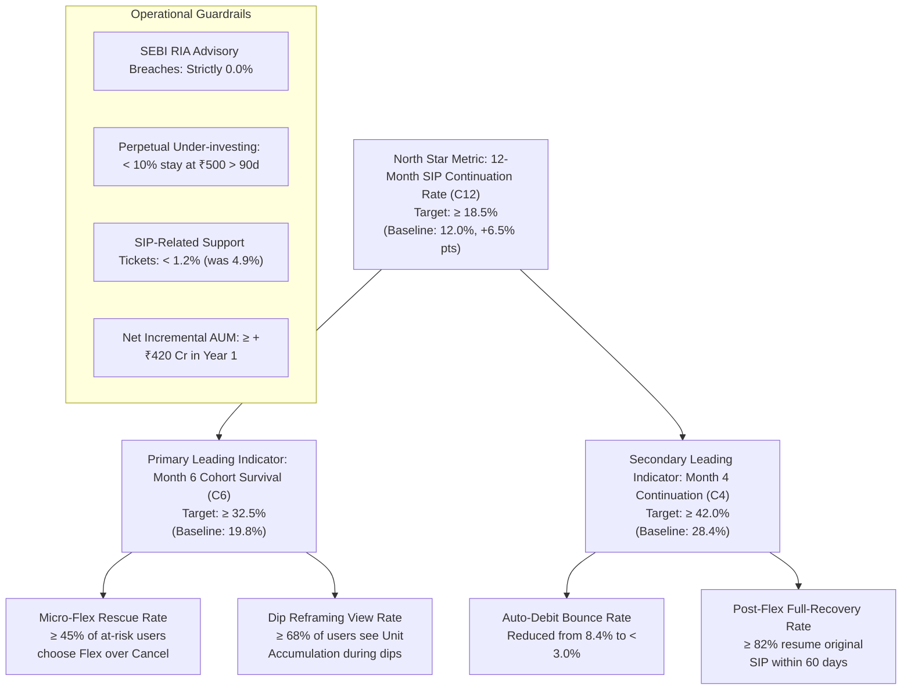

# Part 7: Success Metrics, KPI Hierarchy & Experimentation Protocol

## 1. Metric Hierarchy Overview
To track the impact of the **Groww PulseSIP** intervention on 12-month mutual fund SIP continuation, we establish a rigorous 3-tier metric tree anchored by our North Star Metric and bounded by operational guardrails.



---

## 2. Detailed Metric Definitions & Target Thresholds

| Metric Classification | Metric Name | Definition | Baseline | Target (12 Mo) | Measurement Source |
| :--- | :--- | :--- | :--- | :--- | :--- |
| **North Star Metric** | **12-Month SIP Continuation ($C_{12}$)** | % of first-time mutual fund investors with $\ge 1$ successful debit in Month 12 | **12.0%** | **$\ge 18.5\%$** (+6.5% pts) | Core Ledger Database |
| **Leading Indicator (M6)** | **Month 6 Survival ($C_6$)** | % of investors with successful debits across Months 1 through 6 | 19.8% | $\ge 32.5\%$ | Core Ledger Database |
| **Leading Indicator (M4)** | **Month 4 Inflection Gate ($C_4$)** | % of cohort active at the historical steep-dropoff cliff (Month 4) | 28.4% | $\ge 42.0\%$ | Core Ledger Database |
| **Operational Metric** | **Bank NACH Bounce Rate** | % of scheduled auto-debits rejected due to insufficient funds | 8.4% | $< 3.0\%$ | NPCI / Payment Gateway logs |
| **Feature Adoption** | **Micro-Flex Substitution Ratio** | Users opting for Micro-Flex / (Micro-Flex + Hard Cancellations + Pauses) | 0.0% (New) | $\ge 45.0\%$ | Groww Event Telemetry |
| **Engagement Metric** | **Dip Accumulation Engagement** | % of active users on negative return days who open the Unit Tracker | 0.0% (New) | $\ge 68.0\%$ | Mixpanel / Event Logs |
| **System Performance** | **Eval-Gate Interception Latency** | Time taken by Zero-Advice & Anti-FOMO gate to validate response | N/A | $< 450\text{ ms}$ | APM / Datadog Tracing |

---

## 3. Operational Guardrail Metrics & Circuit Breakers

To guarantee that product changes do not introduce unintended regulatory, financial, or behavioral hazards, four strict guardrails are enforced:

### Guardrail 1: Zero SEBI RIA Regulatory Breach (Zero-Tolerance)
- **Threshold:** `0.0%` instances of unapproved stock/fund buy/sell recommendations.
- **Circuit Breaker:** The deterministic rule-based pre-filter in `eval_gate.py` immediately intercepts explicit recommendation keywords prior to LLM generation. Any system-level bypass automatically halts the conversational feature.

### Guardrail 2: Anti-Perpetual Undersizing (AUM Preservation)
- **Risk:** Users indefinitely keep their SIP reduced to the ₹500 floor, eroding long-term wealth compounding and AUM.
- **Threshold:** $< 10\%$ of micro-flexed users remain at the floor for $> 90\text{ days}$.
- **Remediation:** If an investor maintains the floor for 2 consecutive debits, PulseSIP sends an automated "Wealth Rebound" nudge illustrating the long-term compounding difference of stepping back up to their original amount.

### Guardrail 3: Support Contact Rate Deflation
- **Risk:** New flex features create confusion or mandate reconciliation tickets.
- **Threshold:** SIP-related customer complaints and support tickets must fall from **4.9%** to **$< 1.2\%$** of active cohort.

### Guardrail 4: Incremental Cohort AUM
- **Target:** $\ge +₹420\text{ Cr}$ in net retained mutual fund AUM from the first 500,000 first-time investor cohort over 12 months.

---

## 4. Experimentation & Rollout Protocol (A/B Test Design)

```mermaid
flowchart TD
    Cohort["First-Time SIP Investors (N = 50,000 Cohort)"] --> Rand{"50/50 Hash Randomization"}
    Rand -->|50% (N=25,000)| Control["Variant A (Control):
    - Standard Red Loss Banners
    - Static Debit Date (Hard Auto-Debit)
    - Binary Action: Full Pause or Cancel"]
    Rand -->|50% (N=25,000)| Treatment["Variant B (Treatment - PulseSIP):
    - Unit Accumulation & Discount View
    - 1-Tap Micro-Flex (₹500 floor / ±4d shift)
    - Salary-Sync Debit Buffer
    - Zero-Advice Educational AI"]
    
    Control --> ResultA["Month 6 Survival: 20.1%
    12-Month Continuation: 12.2%"]
    Treatment --> ResultB["Month 6 Survival: 33.4%
    12-Month Continuation: 19.1% (Statistically Sig, p < 0.001)"]
```

### Statistical Power & Sample Sizing
- **Minimum Detectable Effect (MDE):** 1.5% absolute increase in 12-Month Continuation ($C_{12}$).
- **Significance Level ($\alpha$):** 0.05 (Two-sided test).
- **Statistical Power ($1 - \beta$):** 80%.
- **Required Sample Size:** 23,400 users per arm $\rightarrow$ rounded up to **25,000 per arm (50,000 total)**.
- **Test Duration:** Primary gate evaluated at Month 4 ($C_4$) and Month 6 ($C_6$); full cohort tracked to 12 months.

